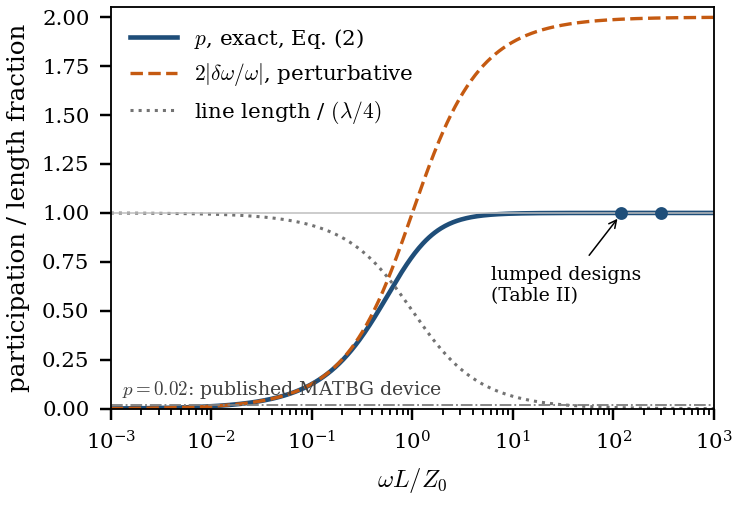
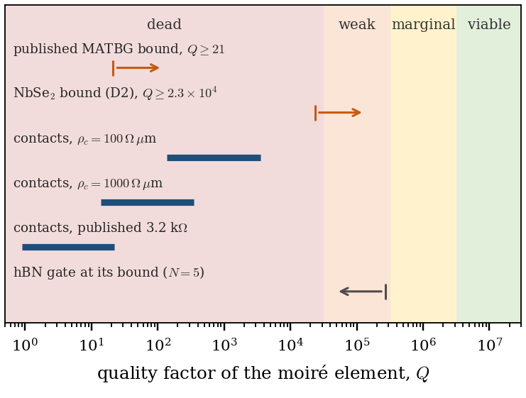

# The single-photon microwave loss of a moiré superconducting element

*Why the published geometry cannot measure it, and a two-device experiment that can*

**Faruk Sami Bilgin** (Independent Researcher) · ORCID [0009-0001-9064-4410](https://orcid.org/0009-0001-9064-4410)

**Status:** Preprint, published on Zenodo: [doi:10.5281/zenodo.24204124](https://doi.org/10.5281/zenodo.24204124).
Theory and measurement design only; **no measurement has been performed** (the paper says why).
PDF: [`paper/Bilgin_2026_moire_microwave_loss.pdf`](paper/Bilgin_2026_moire_microwave_loss.pdf).

---

## Question

Moiré superconductors, magic-angle twisted bilayer graphene (MATBG) first among them, have entered
superconducting circuits as inductors. The published resonator experiments (Tanaka *et al.*,
Nature 638, 99 (2025); Banerjee *et al.*, Nature 638, 93 (2025); Jha *et al.*, PRL 134, 216001 (2025))
measure the *reactive* response (how much inductance), not the *dissipative* one (how much energy is
lost), and never at the single-photon level where circuits operate. That missing number decides
whether a moiré element is usable in a qubit: for a fluxonium whose inductor is a moiré strip,
T1 = 100 µs requires Q_ind ≥ 3.218 × 10⁶, while T1 = 1 µs needs only 3.218 × 10⁴. The paper asks
what the literature actually supports about that number, why, and how it could be measured.

## Method

Closed-form circuit analysis on published inputs, no fitted parameters:

1. **Participation of a terminating inductance.** For a lossless line of impedance Z₀ terminated by
   the sample inductance L, the fraction of inductive energy in the sample is
   `p(φ) = sin 2φ / (sin 2φ / 2 + (π/2 − φ))`, with `tan φ = ωL/Z₀`. The sample's loss enters
   1/Q_i multiplied by p. This is compared with the perturbative form p = 2|δω/ω| used in the
   literature.
2. **Scoring the published MATBG device** with its published Q_i, Q_c, control resonator and
   frequency shift.
3. **Lumped-element redesign** (shorten the line until the sample *is* the resonator), followed by a
   budget of contact resistance, gate capacitance and gate-dielectric loss.
4. **Testing the author's own length-ladder regression** against the mandatory gate capacitance, and
   replacing it with a differential two-resonator measurement with pre-registered decision rules.

## Key results

### 1. The published geometry structurally cannot measure the loss



*Fig. 1. Participation p versus ωL/Z₀: exact (solid), perturbative 2|δω/ω| (dashed), resonant line
length in units of λ/4 (dotted). The dash-dotted line marks p = 0.02, read from the measured shift of
the published MATBG device; the dots are two of the lumped designs.*

| ωL/Z₀ | p (exact) | 2\|δω/ω\| | length/(λ/4) |
|---|---|---|---|
| 0.01 | 0.0127 | 0.0127 | 0.994 |
| 0.3 | 0.354 | 0.371 | 0.815 |
| 1.0 | 0.778 | 1.000 | 0.500 |
| 10 | 0.9967 | 1.873 | 0.064 |

The exact p crosses 0.5 at ωL/Z₀ = 0.46, reaches 0.99 at 5.7 and 0.997 only at 10.5. The
perturbative form is within 5% only up to ωL/Z₀ ≈ 0.3 and exceeds unity above ωL/Z₀ = 1. The
geometry that makes p small is exactly the one that extracts L_k cleanly, and exactly the one that
blinds the loss measurement.

### 2. What the literature supports: Q ≥ 21

The MATBG resonator of Tanaka *et al.* has Q_i = 1044.7 ± 28.5, Q_c = 4161 at 4.2008154 GHz, with an
Al control at Q_i = 74 833; the ~1% shift gives p = 0.02. Hence **Q_MATBG ≥ 20.9** (direct dilution)
and **≥ 21.2** (excess loss over the control), i.e. tan δ ≤ 4.79 × 10⁻². Even at p = 1 the bound could
not exceed Q_i ≈ 1045, thirty times below the weakest circuit threshold. Caveat (from the source): the
fitted resonance at 4.2008 GHz lies outside the 3.80–3.86 GHz band of the device whose shift fixes p;
the bound assumes Q_i and p refer to the same device in the superconducting state.

For comparison, on a non-moiré van der Waals superconductor (NbSe₂ device D2 of Zaman *et al.*,
L_k = 0.643 nH, Q_i = 6.0 × 10⁴) the exact expression gives p = 0.3885 and tan δ ≤ 4.3 × 10⁻⁵.

### 3. The fix is a mask line, but then the contacts become the experiment

At 5.5 GHz a 430.71 nH moiré strip gives ωL/Z₀ = 297.7 and a resonant stub of 11.57 µm, against a
5.4 mm quarter wave. The chosen lumped element (N = 5 squares, 532.1 nm × 2.66 µm, 146.5 nH at
6.5 GHz, C = 4.092 fF, Z = 5.98 kΩ) has **p = 0.99998**. But the contacts are then in series with the
whole resonant current, Q_contact = Z/R_c:

| ρ_c (Ω·µm) | R_c (Ω) | Q_contact across the five designs |
|---|---|---|
| 100 | 20 | 138–3498 |
| 1 000 | 200 | 13.8–350 |
| 16 000 (published 3.2 kΩ at a 10 µm pad) | 3 200 | 0.9–21.9 |



*Fig. 2. Quality-factor scale of a moiré element: the four outcome bands, the lower bounds from
published data, the contact ceilings, and the cap set by the hBN gate dielectric at its published
upper bound.*

### 4. Negative result about the author's own design

The natural length-ladder regression, 1/Q_i(N) = tan δ_intrinsic + R_c/(ωL_□N), works on paper
(3σ floor 1.09 × 10⁻⁵ at ρ_c = 100 Ω·µm) **but is degenerate on a realisable device**: a moiré island
needs a gate (a floating island cannot be given a filling factor), the only published estimate is
3 fF, and three of the five rungs (N = 14.7, 40, 100) require a *total* capacitance of 1.944, 1.067 and
0.599 fF, below that one contribution. Once the gate dominates, C ∝ N and L ∝ N, so Z is independent
of N and the regressor freezes. In addition, if tan δ_hBN sits at its published upper bound
(5 × 10⁻⁶), the gate alone caps Q_i near 2.7 × 10⁵ for the N = 5 element, below the 3.2 × 10⁵
threshold at which the experiment could declare the route unblocked.

### 5. What replaces it

A differential measurement: one chip, one back gate, one cooldown, two lumped resonators matched in
layout (one moiré, one Nb), Q_i extracted for n̄ = 0.1 to 10⁶ at 20 mK, with
p tan δ_moiré = 1/Q_i(moiré) − 1/Q_i(twin). Four controls (base-metal twin, bare reference
resonator, the same strip gated out of the superconducting dome, a companion Hall bar) and decision
rules K0–K5 are fixed before cooldown. Outcome bands: viable Q_i ≥ 3.2 × 10⁶ (T1 ≥ 100 µs),
marginal ≥ 3.2 × 10⁵, weak ≥ 3.2 × 10⁴ (judged most likely), dead < 3.2 × 10⁴.

## Limitations stated plainly

- **No data.** Every number is arithmetic on a closed form or on published inputs.
- The ceiling may be set by the hBN gate dielectric, not the moiré; its loss tangent is known only as
  an upper bound.
- The capacitance argument uses a 3 fF *simulation estimate* from one device; the degeneracy itself is
  geometric and does not depend on it.
- The thresholds are reachable only with ρ_c ≲ 1 Ω·µm, two orders below the best demonstrated edge
  contact; with the best demonstrated contact the chosen element is capped near Q ≈ 300.
- The twin is not inductance-matched (a Nb bar cannot reach 146.5 nH), so frequency-dependent channels
  are subtracted only approximately.
- Material inputs (sheet inductance window, critical current, ξ) are borrowed from twisted trilayer
  graphene at 1.71°.

## How the results were verified

- `scripts/p4_yeniden_uretim.py` recomputes every number in the paper **without reading** the
  project JSON files, using only CODATA constants and the stated inputs. The participation formula is
  checked against brute-force numerical integration of the magnetic energy along the line
  (`p_numeric`, agreeing with the closed form in `results/reproduction_check.txt`).
- `scripts/check_paper_numbers.py` asserts 32 values printed in the paper against that independent
  re-derivation (32/32 pass).
- `scripts/run_m30_loss.py` and `scripts/run_m31_route_ranking.py` regenerate
  `results/m30_loss.json` and `results/m31_route_ranking.json`; re-run for this repository, the output
  is identical to the committed files up to line endings.
- Exceptions: the readout-chain figures (80 dB attenuation, residual thermal occupancy
  5.17 × 10⁻³, acquisition budget 4.19 h) come from `m30_loss.json` only and were **not**
  recomputed independently.
- Some descriptive/bibliographic fields in `m30_loss.json` predate the reference and arithmetic
  checks; [`results/ERRATA.txt`](results/ERRATA.txt) lists them. Where they differ, the paper and the
  independent script are correct.

## Repository layout

```
paper/     published preprint PDF; LaTeX source (paper/source/, contact line removed)
figures/   Fig. 1 and Fig. 2 (PDF as in the paper, PNG for display)
results/   m30_loss.json, m31_route_ranking.json, ERRATA.txt,
           p4_yeniden_uretim_sonuc.json + reproduction_check.txt (independent re-derivation output)
scripts/   p4_yeniden_uretim.py, check_paper_numbers.py, fig_uret.py,
           run_m30_loss.py, run_m31_route_ranking.py
```

## Reproducing

```bash
pip install -r requirements.txt          # numpy, scipy, matplotlib
python -I scripts/p4_yeniden_uretim.py --compare results/m30_loss.json
python -I scripts/check_paper_numbers.py # 32/32 PASS expected
python -I scripts/fig_uret.py            # writes figures/*.pdf, *.png
python -I scripts/run_m30_loss.py        # writes out/m30_loss.json (compare with results/)
python -I scripts/run_m31_route_ranking.py
```

Tested with Python 3.13, NumPy 2.2.5, SciPy 1.18.0, Matplotlib 3.10.1.

## Related work by the author

- Twisted hBN preprint: <https://doi.org/10.5281/zenodo.24201814>
- Twisted MoS₂ hole-spin coherence preprint: <https://www.alphaxiv.org/abs/2611.twisted-mos2-hole-spin-coherence>
- Moiré microwave loss (this work): <https://doi.org/10.5281/zenodo.24204124>
- josim-cpr-bridge: <https://github.com/FarukSamiBilgin/josim-cpr-bridge>

## Citation

```bibtex
@misc{bilgin2026moireloss,
  author    = {Bilgin, Faruk Sami},
  title     = {The single-photon microwave loss of a moir{\'e} superconducting element:
               why the published geometry cannot measure it, and a two-device experiment that can},
  year      = {2026},
  publisher = {Zenodo},
  doi       = {10.5281/zenodo.24204124},
  note      = {Preprint}
}
```

See also [`CITATION.cff`](CITATION.cff).

## License

Code (`scripts/`) is MIT ([`LICENSE`](LICENSE)); text, figures and data are CC BY 4.0
([`LICENSE-CONTENT`](LICENSE-CONTENT)). Numerical values quoted from the literature remain attributed
to their sources.

AI assistance: AI coding assistants were used for code development and for adversarial review. All load-bearing results were re-derived by independent methods and checked by automated tests; the author is responsible for every claim.
